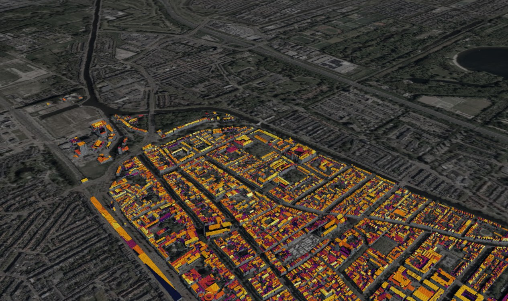
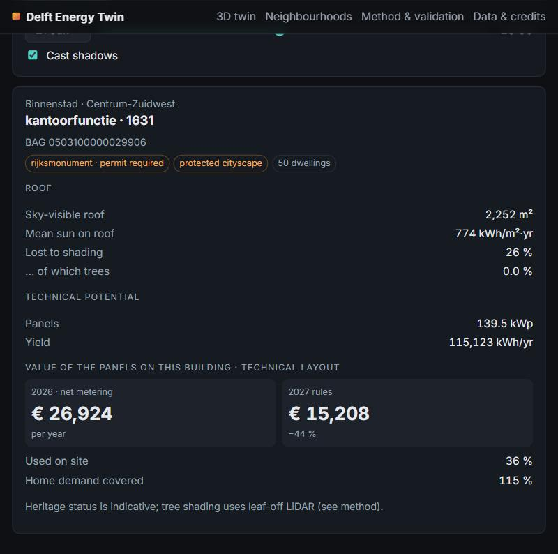
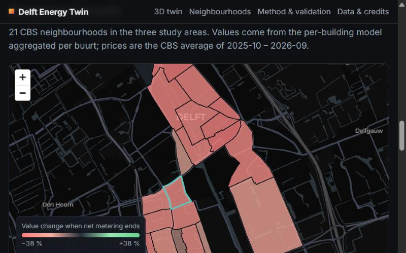
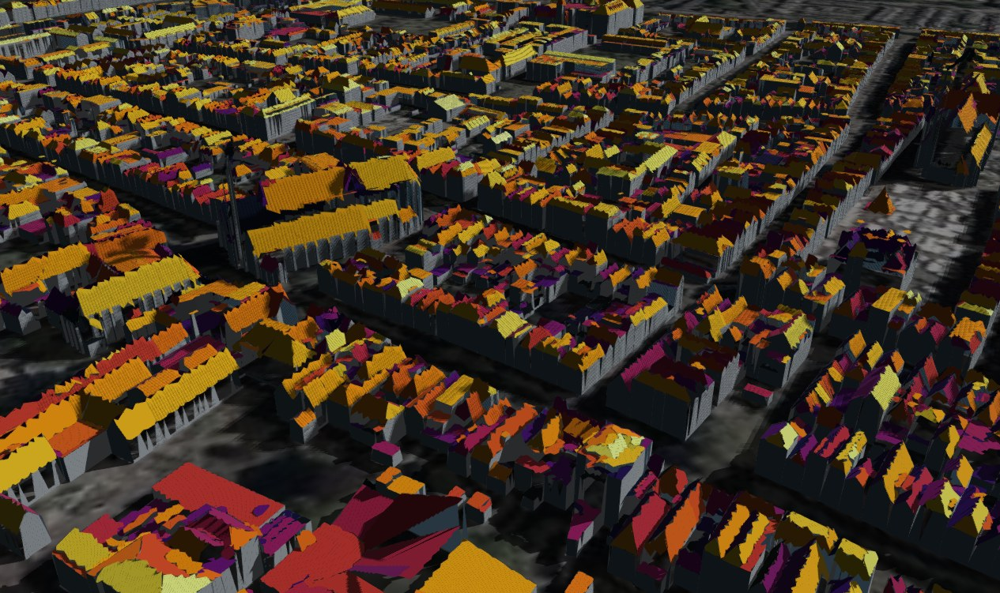
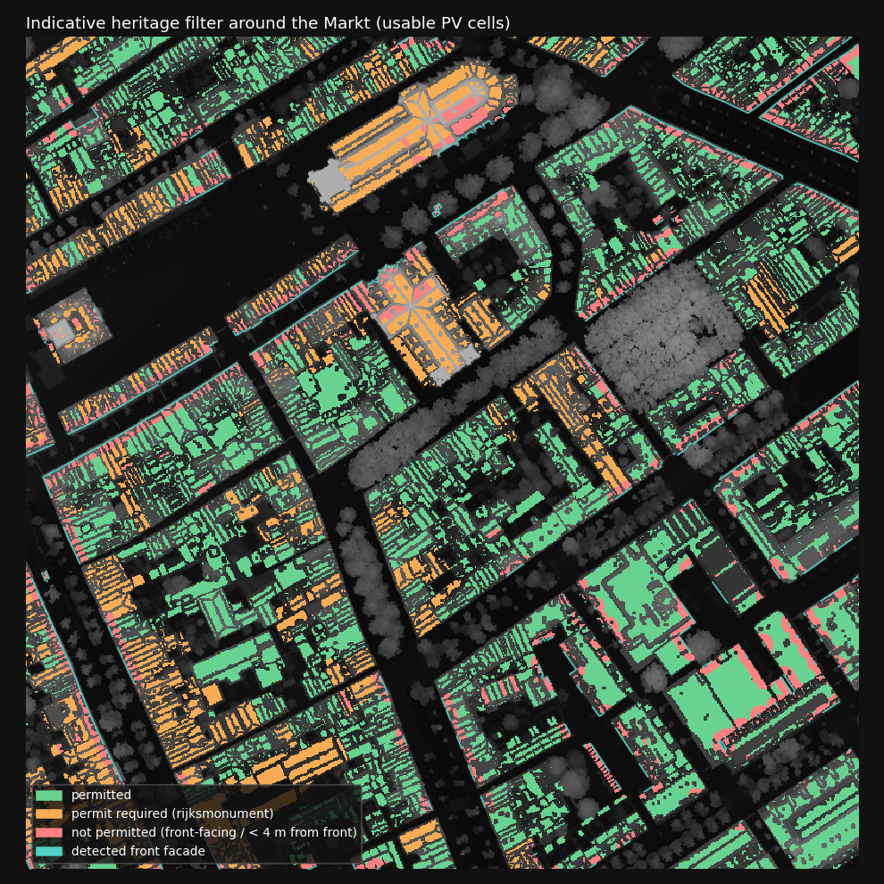
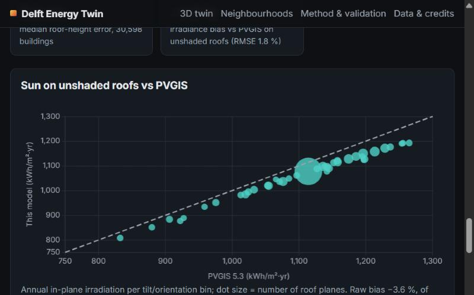
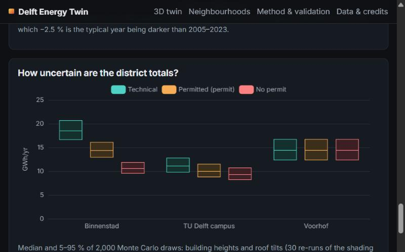

# From Point Cloud to Prosumer — a LiDAR Energy Digital Twin of Delft

**Shadow-aware rooftop solar potential from the newest Dutch LiDAR (AHN6), with heritage constraints and the end of
net metering on 1 January 2027 — published as an interactive 3D web twin.**



> Delft's historic centre could produce **18.5 GWh** of solar power a year on its roofs (5–95 %: 16.6–20.7 GWh).
> Heritage rules allow **10.6–14.4 GWh**, and when net metering ends, panels on its homes lose **34 %** of their annual
> value — 15 % with a 5 kWh home battery.

Live site: *add your GitHub Pages URL here after the first deploy* · Report-style notes: [PLAN.md](PLAN.md) ·
All numbers: [`results/metrics.json`](results/metrics.json)

## What it does

| | |
|---|---|
| **Reconstruction** | 442 million AHN6 points (flown 19 Dec 2025 / 19 Jan 2026, 20–31 building pts/m²) over 14 tiles → DSM/DTM/vegetation rasters → roof planes per BAG building (numba region growing), 31,400 buildings, 412 crossing tile edges reconstructed whole |
| **Solar model** | per 0.5 m roof cell: 72-direction horizon scan (200 m), sun map from the PVGIS-SARAH3 typical year, Hay–Davies sky, trees with seasonal transmissivity |
| **PV & economics** | module layout (flush on pitched roofs, east–west 12° on flat roofs), hourly self-consumption against the 2026 NEDU/MFFBAS household profile and CBS demand, optional battery, value under 2026 net metering vs 2027 rules (CBS tariffs) |
| **Heritage** | indicative filter in the RCE protected cityscapes: no panels within 4 m of a street-facing façade (line-of-sight to BGT public space) or on roof faces sloping towards it; rijksmonumenten need a permit |
| **Change** | AHN5 (2023) → AHN6 (2025/26): new / raised / lowered buildings, demolitions, and rooftop PV installed since 2023 |
| **Web twin** | Vite + CesiumJS (self-hosted 3D Tiles, no Cesium ion token) + MapLibre + ECharts; CityJSON 2.0 export with solar attributes per roof surface |

## Results

| GWh/yr, median (5–95 %) | Technical | Permitted (monuments with permit) | Permitted without permit | Home demand covered | Value change 2027 (with battery) |
|---|---|---|---|---|---|
| Binnenstad | 18.5 (16.6–20.7) | 14.4 (12.9–16.1) | 10.6 (9.5–11.9) | 70 % | −34 % (−15 %) |
| TU Delft campus | 11.1 (9.8–12.8) | 10.0 (8.8–11.5) | 9.3 (8.2–10.7) | 44 % | −27 % (−10 %) |
| Voorhof | 14.4 (12.4–16.7) | = technical | = technical | 57 % | −28 % (−11 %) |

Uncertainty from a Monte Carlo over building heights and roof tilts (30 re-runs of the shading model), weather year
2005–2023, performance ratio, tree transmissivity and flat-roof layout. Prices: CBS average Oct 2025 – Sep 2026,
€0.260/kWh avoided, €0.060/kWh exported from 2027 (50 % of the bare supply tariff).

<table><tr>
<td width="50%"><br><sub>Building inspector: roof, shading, PV for the selected scenario, value before/after 2027, heritage flags.</sub></td>
<td width="50%"><br><sub>Neighbourhood dashboard: change in PV value when net metering ends, per CBS buurt.</sub></td>
</tr><tr>
<td><br><sub>Sun &amp; shadow control: canal houses at 09:30 on 21 June.</sub></td>
<td><br><sub>Indicative heritage filter around the Markt: permitted, permit required, not permitted.</sub></td>
</tr></table>

## Validation

| Check | Reference | Result |
|---|---|---|
| Roof planes | Kadaster 3D Basisvoorziening 2025 (roofer on AHN5) | 99.3 % of planes ≥ 10 m² matched; median slope error 0.60°; median plane offset 5.3 cm |
| Roof heights | same, 30,598 buildings | median absolute error 5.2 cm (after converting the reference's above-ground heights to NAP) |
| Irradiance | PVGIS 5.3, 4,069 unshaded planes in 40 tilt/orientation bins | bias −1.2 %, RMSE 1.8 % (raw −3.6 %, of which −2.5 % is the typical year being darker than 2005–2023) |
| Campus total | Zhou et al. 2022, *Solar RRL* 6, 2100478 (roofs ≈ 4.7 GWh/yr) | our 9.65 GWh/yr → 6.2 GWh/yr with their module, threshold and 2014 building stock (×1.32 remaining) |
| Change detection | BAG construction year | 96.5 % of detected new buildings built ≥ 2023; recall 94 % for new buildings ≥ 30 m² on empty sites |
| Yield sanity | 875 kWh/kWp planning norm | median 786 kWh/kWp (p90 898) across all suitable planes |

 

## Limitations

- The heritage layer is **indicative**: rules come from a 2019 report on Delft's protected-cityscape policy; current
  municipal criteria and municipal monuments are not included.
- AHN6 was flown **leaf-off**; tree shading is varied in a sensitivity test (district loss ≤ 3 %, but the share of
  buildings losing > 10 % changes 2–4× between scenarios).
- Demand is CBS 2024 grid delivery per dwelling (gross use is not published for 2024); non-residential demand is not
  modelled. Supplier feed-in costs and installation cost are not included; CO₂ avoided is not shown (no sourced factor).
- Web geometry is simplified (roof fragments < 4 m² merged for display); solar results stay per original plane.

## Run it

Requirements: Python 3.12 with [uv](https://docs.astral.sh/uv/), Node.js 24 LTS. About 4.5 GB of open data is downloaded.

```bash
uv sync
```

```bash
uv run python -m delft_twin.pipeline preprocess --all --workers 3
```

Then, in order: `uv run python -m delft_twin.pipeline segment --all`, `validate --all`, `solar --all`, `city`;
`uv run python -m delft_twin.sensitivity`, `change`, `pv`, `heritage`, `uncertainty`, `export`, `mesh`, `figures`
(each as `python -m delft_twin.<name>`). Tests: `uv run pytest`.

Website (reads `web/public/data`, written by the export and mesh steps):

```bash
cd web && npm ci && npm run optimize-tiles && npm run dev
```

## Repository layout

```
src/delft_twin/   pipeline: data, preprocess, segment, solar, validate, city, change, pv, heritage, uncertainty, export, mesh
configs/          config.yaml, study areas (aois.geojson)
tests/            pytest (solar physics, tile edges, PV layout, heritage, mesh, glTF)
results/          metrics.json, figures/
web/              Vite site; public/data = 3D Tiles, CityJSON, GeoJSON, site.json
docs/screenshots/ README images
PLAN.md           decisions, validation details, open items
```

## Data & licences

AHN6 / AHN5 (Het Waterschapshuis, CC-BY) · BAG, BGT, 3D Basisvoorziening (Kadaster via PDOK) · CBS wijken en buurten
2024 and tariffs 85592NED (CC BY 4.0) · standard load profiles 2026 (MFFBAS/NEDU) · PVGIS 5.3 (EC JRC) ·
rijksmonumenten and protected cityscapes (RCE via PDOK) · aerial photo (Beeldmateriaal Nederland via PDOK, CC BY 4.0) ·
basemap © OpenStreetMap contributors © CARTO · campus benchmark: Zhou et al. (2022), *Solar RRL* 6, 2100478.

## About

A portfolio research project by Emna Saada, geoinformatics engineering student.
