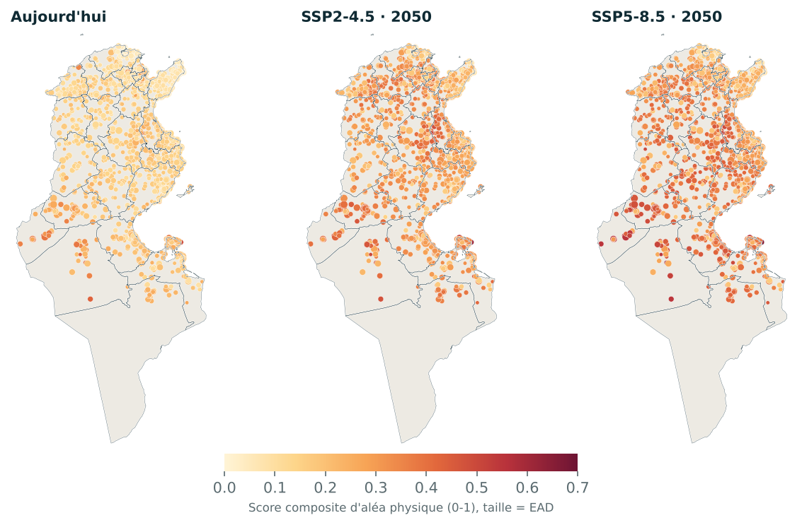

# ClimaRisk Tunisie

**Physical climate risk of a bank loan portfolio in Tunisia**: geospatial scoring of heat, drought, flood and wildfire for every loan, CMIP6 / NGFS scenarios at 2030 and 2050, translation into PD / expected-loss adjustments, and aggregation by sector and governorate. Includes a Streamlit dashboard, an automatic French PDF report and an animated demo video.

> ⚠️ **The portfolio is 100 % synthetic.** No real client and no real bank data are used, in line with Tunisian organic law n° 2004-63 on personal data protection. All monetary figures are illustrative and must be calibrated on real bank data before any use.



## Quick start (3 commands)

```bash
make install      # uv sync --all-extras
make data         # open data: NEX-GDDP-CMIP6, Aqueduct, WorldCover, WorldPop, geoBoundaries (~15-30 min)
make demo         # pipeline -> outputs/kpis.json, maps, docs/report.pdf
```

Then `make app` opens the dashboard at http://localhost:8501, and `make video` renders `video/out/climarisk_demo.mp4`.

## What it does

1. **Synthetic portfolio** — 2 000 loans over the 24 governorates, 10 sectors inspired by the Tunisian economy (cereals, olives, citrus, agrifood, textile, coastal tourism, housing, construction, chemicals & phosphates, energy).
2. **Hazards** — days with Tmax > 35 °C and drought (consecutive dry days, precipitation change) from 5 CMIP6 models (NASA NEX-GDDP); 100-year flood depth (WRI Aqueduct); wildfire fuel (ESA WorldCover).
3. **Credit** — `PD_s = PD · (1 + β · Score)`, flood-driven LGD uplift, `EL = PD · LGD · EAD`; every coefficient lives in `config/assumptions.yaml` with a sensitivity analysis.
4. **Aggregation & reporting** — by sector, governorate and scenario, median and 10–90 % band across climate models; Pillar-3-inspired tables (BCBS voluntary framework, June 2025); compliance matrix BCBS / NGFS / EBA / ECB / IFRS S2 / BCT.

| Illustrative result (synthetic) | Today | SSP2-4.5 · 2050 | SSP5-8.5 · 2050 |
|---|---|---|---|
| EAD in a high-hazard zone | 1.5 % | 16.9 % | 22.4 % |
| Additional climate EL (bp of EAD) | 15.5 | 26.5 | 29.5 |

## Repository

```
config/       assumptions, portfolio, scenarios, regulatory matrix (YAML)
scripts/      open-data downloaders (no account needed)
src/climarisk portfolio, hazards/, vulnerability, credit, pipeline, maps, reporting, physrisk_compare, cli
app/          Streamlit dashboard (7 tabs)
tests/        pytest with tiny in-repo data
docs/         methodology, research_log, LICENSES_DATA, regulatory_matrix, report.pdf
video/        Remotion project (props generated from outputs/kpis.json)
```

## Limits

Synthetic portfolio; 0.25° climate grid; 5 models and 3-year windows; Aqueduct relies on CMIP5; β, γ and vulnerability weights are not estimated; physical risk only (no transition risk). The NGFS Phase V damage function (Kotz et al., 2024 — retracted) is deliberately not used. See `docs/methodology.md`.

## Licences

Code: MIT. Data: see `docs/LICENSES_DATA.md` (CC BY 4.0, ODbL, public domain). CLIMADA (GPL-3.0) is not used.

---
Emna Saada — géoinformatique, MSE (Université de la Manouba).
