# ClimaRisk Tunisie: results

**What this page is.** A plain-language summary of what the pipeline found, with the figures that support each point. Every number comes from `outputs/kpis.json`, produced by `make run` on a **100 % synthetic portfolio** of 2,000 loans. The numbers show how the method behaves. They do not describe any Tunisian bank.

Interactive version: the results website in [`site/`](../site/index.html) (`make site`, then `python -m http.server -d site`), published with GitHub Pages. Full method in French: [`docs/report.pdf`](report.pdf). Technical notes: [`docs/methodology.md`](methodology.md).

---

## 1. The headline

Under the high-emissions scenario SSP5-8.5, the share of the loan book that sits in a high-hazard zone grows **from 1.5 % today to 22.4 % by 2050**. The five climate models disagree on how fast, with a range of 18.7 % to 44.3 %, but none of them shows the share staying near today's level.

The climate-adjusted extra expected loss rises from 4.6 M TND under today's climate to **8.8 M TND in 2050** (range 8.0 to 10.4 M), which is **29.5 basis points** of the 3 bn TND book. Measured model by model against today, that is **+4.8 M TND** (range +3.3 to +5.7 M).

| Scenario | Book in a high-hazard zone | Extra expected loss | bp of exposure | Change vs today |
|---|---|---|---|---|
| Today (2010–2014 climate) | 1.5 % | 4.6 M TND | 15.5 | reference |
| SSP2-4.5 · 2030 | 3.0 % (1.5–8.3) | 5.2 M (5.1–5.6) | 17.4 | +0.8 M |
| SSP2-4.5 · 2050 | 16.9 % (9.2–40.1) | 7.9 M (6.8–9.7) | 26.5 | +3.4 M |
| SSP5-8.5 · 2030 | 8.7 % (3.2–16.9) | 6.5 M (5.6–7.6) | 21.6 | +1.8 M |
| SSP5-8.5 · 2050 | 22.4 % (18.7–44.3) | 8.8 M (8.0–10.4) | 29.5 | +4.8 M |

Ranges are the 10th to 90th percentile across five CMIP6 models. "Extra expected loss" compares against a climate-neutral PD, which is why it is not zero today.

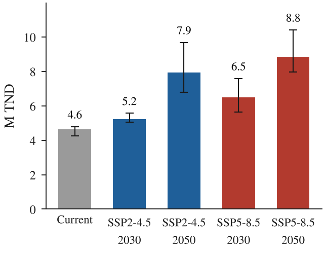
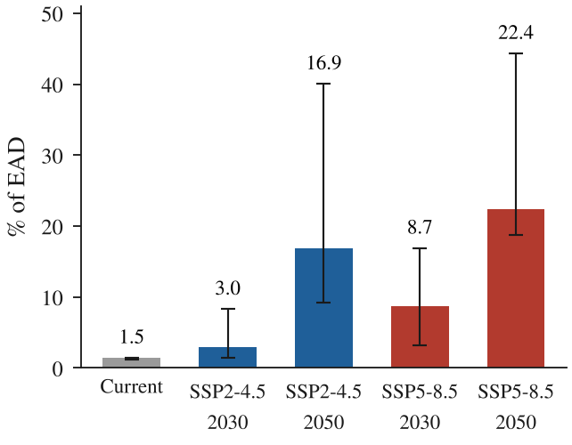

## 2. What drives it: heat first, then drought

At the loan locations, days above 35 °C go from **36 per year today to 68 in 2050** under SSP5-8.5. The longest dry spell lengthens from 78 to 96 days, and annual rainfall falls by about **21 %** relative to each model's own 2010–2014 run. Heat moves from the south towards the north. By 2050 the centre of the country looks like today's south.

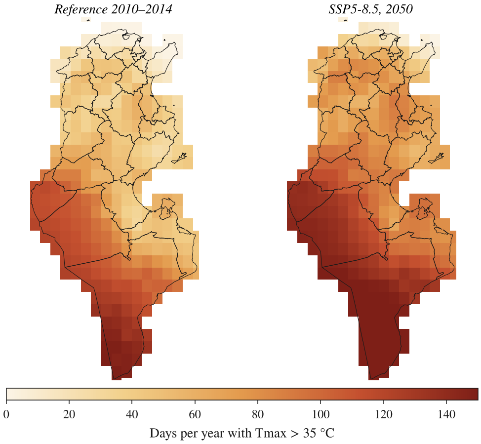
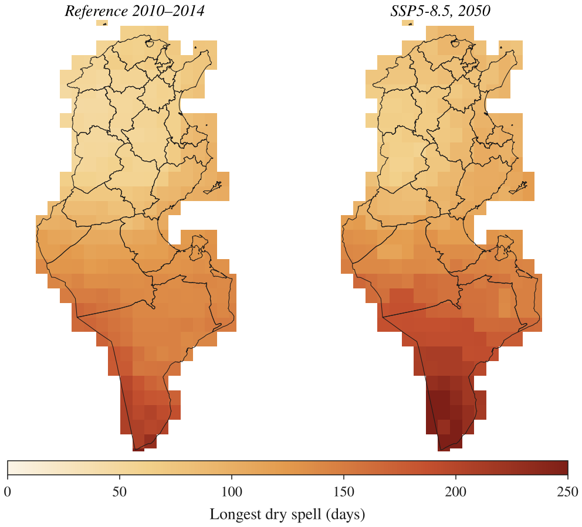

The 2030 rainfall figures carry little signal. Each horizon uses only three years per model, so year-to-year variability dominates. One scenario even shows a wetter 2030 (+11 %). The 2050 drying is consistent across both scenarios.

Flood and wildfire matter locally but move little over time in this setup. The 100-year flood concentrates in the Medjerda valley, around Tunis and on the Sahel coast. Wildfire fuel concentrates in the north-western forests (Kroumirie, Mogods) and on the Dorsale.

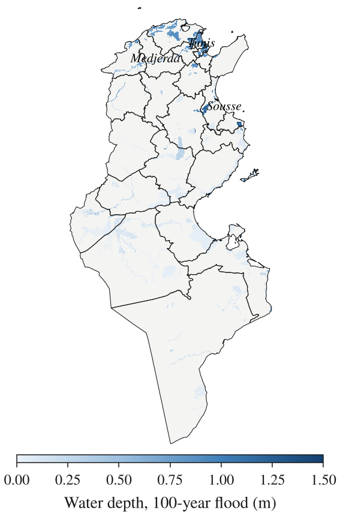
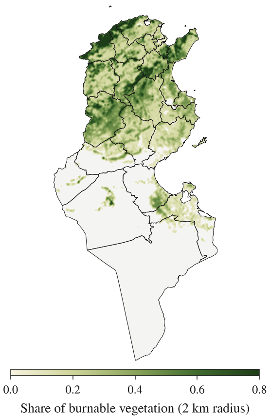

## 3. Who carries the risk

Rain-fed agriculture takes the largest hit relative to its size. Under SSP5-8.5 in 2050, extra expected loss reaches **84 bp for cereals** and **71 bp for olives**, compared with 6 bp for housing loans. Construction (48 bp) and citrus (43 bp) follow.

The heatmap shows why. Heat scores above 0.5 for almost every sector by 2050, so it raises everyone's floor. Drought then separates the sectors, because the vulnerability weights make farming far more sensitive to it.

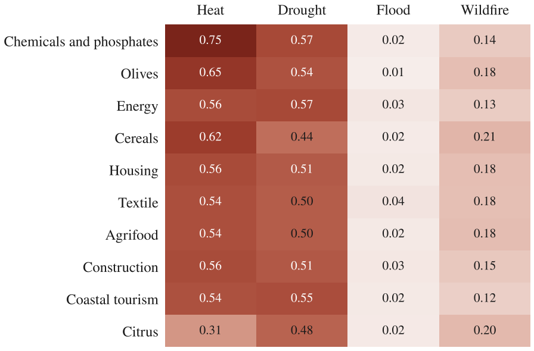

Geographically, the inland north-west and centre carry the most extra loss per dinar lent: **El Kef (63 bp), Siliana (50), Zaghouan (46), Sidi Bouzid (45) and Gafsa (38)**. These are the governorates where cereal farming meets the strongest drying.

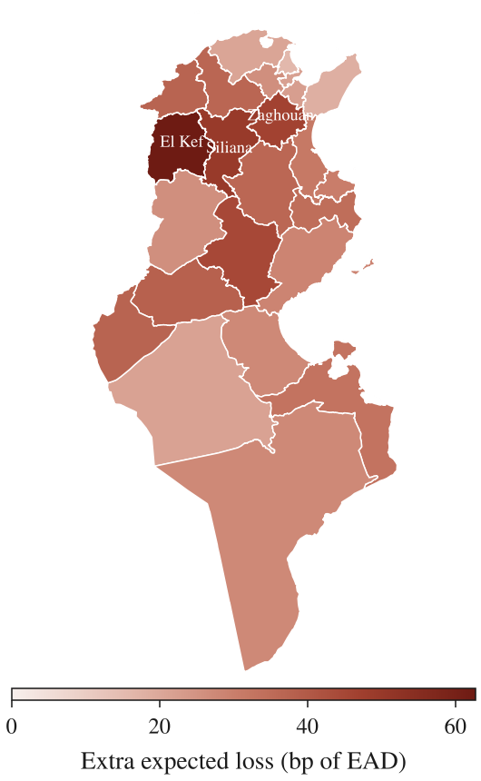
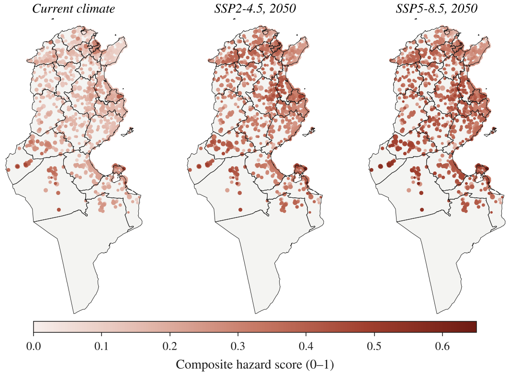

## 4. How much to trust it

**The credit assumption matters more than the climate model.** Halving or doubling the PD elasticity β moves the result by −49 % to +98 %. The spread across climate models moves it by only −10 % to +18 %. Changing any hazard weight by 25 % moves it by less than 7 %.

One result looks odd at first: giving flood *more* weight slightly *lowers* the loss. Flood scores are low for most loans, and the composite score is a weighted average, so a heavier flood weight pulls the average down. Calibrating β on defaults observed after Tunisian droughts and floods would reduce the uncertainty far more than adding climate models would.

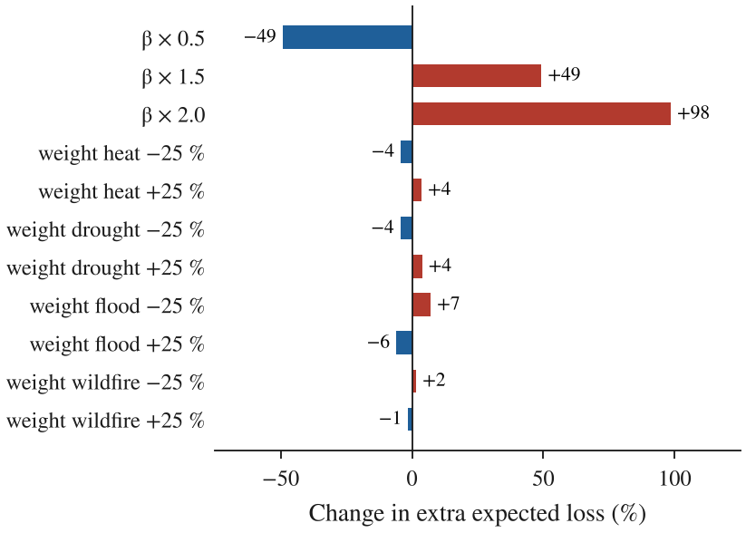

**Cross-check with OS-Climate physrisk.** At the same 2,000 locations, ClimaRisk's heat indicator ranks places the same way as physrisk's (Spearman 0.66 today, 0.88 in 2050). The two drought indicators rank places in *opposite* order (−0.65). physrisk uses SPEI, which measures drought relative to each place's usual climate and so flags the wetter north. ClimaRisk uses dry-spell length, which is absolute and so flags the arid south. Both say drought worsens for every loan. Which one fits better depends on the activity being financed, and that choice belongs with the risk team.

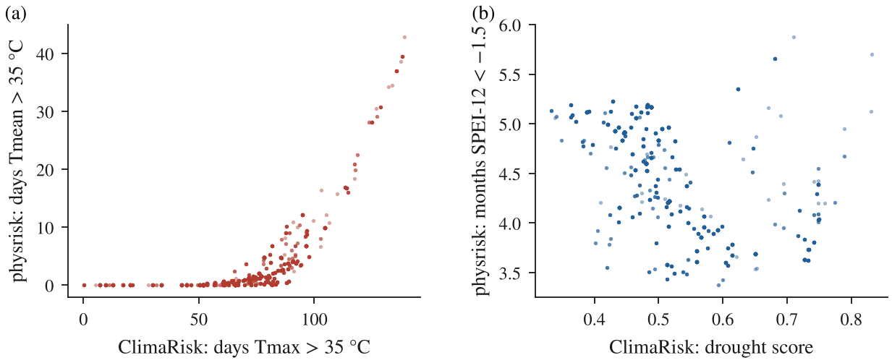

## 5. Limits

- The portfolio is synthetic. Sector shares, PDs and LGDs are documented assumptions, not BCT statistics.
- Climate data is on a 0.25° grid (about 25 km). Flood data is at about 1 km, which misses urban run-off and small wadis.
- Five models and three years per horizon. A production version would use 20-year windows and more models.
- Aqueduct floods use CMIP5 projections and an observation-driven baseline. The change in flood risk over time is therefore not like-for-like, and the CMIP6-to-Aqueduct model pairing is arbitrary.
- β, γ and the vulnerability weights are illustrative, not estimated.
- Physical risk only: no transition risk and no second-round effects.
- The NGFS Phase V GDP-damage function relies on Kotz et al. (2024), which has been retracted (NGFS statement, 3 December 2025). It is not used here.

## 6. Reproduce

```bash
make install && make data && make demo
```

`make app` opens the local dashboard. `python scripts/export_dashboard_data.py` rebuilds the tables behind the online dashboard. `python scripts/make_linkedin.py …` and `node scripts/render_linkedin.js` rebuild the carousel in `docs/linkedin/`.
